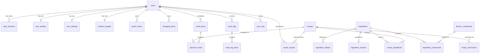

# DRISHYAM — Database Architecture & Schema Reference

DRISHYAM uses **PostgreSQL 15+** with asynchronous connection pooling via **SQLAlchemy 2.0 (`asyncpg`)** and schema evolution managed via **Alembic**.

---

## 1. Entity-Relationship Overview



---

## 2. Table Specifications

### 2.1 Identity & Access
- `users`: Core account record with `email`, `password_hash` (`scrypt`), `name`, `is_active`.
- `auth_sessions`: Active and revoked sessions with `session_hash` (Web cookie), `access_hash` (Android Bearer), `refresh_hash`, and expiration timestamps.
- `password_reset_tokens`: High-entropy single-use cryptographic tokens with `expires_at` and `used_at`.

### 2.2 User Profile & Calibrated Targets
- `user_profiles`: Biometrics (`age`, `gender`, `height_cm`, `weight_kg`), `activity_level`, `fitness_goal`, `macro_preference`.
- `nutrition_targets`: Daily goals computed via Mifflin-St Jeor: `calories`, `protein_g`, `carbs_g`, `fat_g`, `fiber_g`, `sodium_mg`, `is_custom_override`.
- `user_settings`: Sensory and client preferences (`sound_enabled`, `haptics_enabled`, `reduced_motion`, `measurement_unit`).

### 2.3 Computational Gastronomy & Knowledge Base
- `ingredients`: Canonical ingredients with categories (`category`, `scientific_name`, `display_name`).
- `ingredient_aliases`: Multilingual and colloquial names mapped to canonical IDs (e.g. `haldi` $\to$ `turmeric`, `dhaniya` $\to$ `coriander`).
- `ingredient_nutrition`: Micronutrient and macronutrient foundation data per 100g from USDA Foundation Food data.
- `flavour_compounds`: Chemical flavor molecules (from FlavorDB / Foodoscope) with CAS IDs and odor descriptors.
- `ingredient_compounds`: Association matrix mapping ingredients to compounds.
- `recipes`: Culinary recipes with cuisine, prep/cook times, yield, and source attribution.
- `recipe_ingredients`: Join table with quantities, units, and optional substitution keys.
- `recipe_instructions`: Sequenced step-by-step instructions.

### 2.4 User Pantry & Offline Synchronization
- `pantry_items`: User-held stock items with `name`, `category`, `quantity`, `unit`, `confidence`, `confirmed`, `source` (`android_scanner`, `manual`), `version`, and `deleted_at` (tombstone).
- `sync_ops`: Applied mutation ledger storing `op_id`, `user_id`, `entity`, and `entity_id` for idempotent replay prevention.
- `shopping_items`: Items needed for meal planning or custom addition, with `purchased` boolean toggle.

### 2.5 Planning & Consumption Logs
- `meal_plans`: Named calendar slots.
- `planned_meals`: Day and meal-slot assignments (`breakfast`, `lunch`, `dinner`, `snack`).
- `meal_logs`: Intake journal entries.
- `meal_log_items`: Component ingredients and portions consumed in a logged meal.

---

## 3. Data Integrity & Migrations

1. **Foreign Key Cascades:** Every user-associated entity enforces `ON DELETE CASCADE`. When an account is deleted via `/api/auth/account`, all associated sessions, pantry items, sync ops, and meal logs are purged atomically.
2. **Alembic Versioning:** Migrations are tracked in `backend/migrations/versions/`. Migrations can be applied using:
   ```bash
   cd backend && alembic upgrade head
   ```
